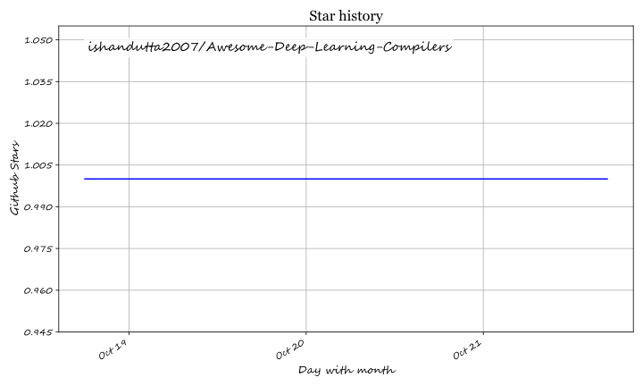

# Awesome-Deep-Learning-Compilers

# Awesome-Deep-Learning-Compilers

## Top Deep Learning Compilers Ecosystem

**Curated List of SaaS Products & Open-Source GitHub Projects**  

*Focused on Model Optimization, Hardware Acceleration & Production Inference*  

**Last updated: October 2026**

This repository tracks notable **SaaS platforms** and **open-source projects** for **Deep Learning Compilers**. These tools enable developers to transform trained models into optimized, hardware-specific executables—from graph-level optimizations and operator fusion to quantization and memory planning—so that inference runs faster and cheaper on CPUs, GPUs, and specialized accelerators.

**Examples** include Apache TVM, NVIDIA TensorRT, ONNX Runtime, Intel OpenVINO, Triton Inference Server, Apple Core ML, AWS Neuron, Qualcomm SNPE, Vitis AI, and TensorFlow Lite (the category leaders).

**Open-source emphasis**: This section is heavily expanded with every major active project for self-hosting, cross-platform compilation, and open inference infrastructure—ideal for ML engineers, platform teams, and organizations seeking transparent, vendor-independent model deployment.

Contributions welcome! Open a PR to add/update entries. Keep descriptions factual and link to official sites.

## Table of Contents

- [SaaS/Hosted Platforms](#saas-hosted-platforms)

- [Open-Source GitHub Projects](#open-source-github-projects)

- [How to Contribute](#how-to-contribute)

- [Disclaimer](#disclaimer)

## SaaS/Hosted Platforms

- **NVIDIA TensorRT (Commercial Support)**

  **SDK for high-performance deep learning inference on NVIDIA GPUs**. The repository contains the **open-source components** of TensorRT—the core builder and runtime are distributed as pre-built binaries with commercial support available . **The reference for NVIDIA GPU inference**—takes an ONNX model, compiles it into a hardware-specific engine, and picks the fastest available GPU kernel for each layer. **Speedup varies by model, precision, batch size, and GPU**—measure with the Performance Benchmarking tools before quoting numbers.

- **Apple Core ML**

  **Apple's framework for on-device inference** on iOS, iPadOS, macOS, tvOS, visionOS, and watchOS . **Note**: The compiler and runtime are **closed-source**—you convert models using `coremltools` (open-source Python package) and deploy through Xcode. **The on-device choice** for Apple platforms—optimizes for the CPU, GPU, and Neural Engine while minimizing memory and power consumption . **Runs entirely on-device**—no network connection required, protecting user data privacy .

- **AWS Neuron**

  **Software stack for high-performance deep learning and generative AI on AWS Inferentia and Trainium instances** . **Note**: Compiler and runtime are **closed-source**—you use the Neuron SDK to compile models for AWS silicon. Features **native PyTorch support**, **vLLM integration** for LLM serving with OpenAI-compatible APIs, **Neuron Explorer** for profiling, and the **Neuron Kernel Interface (NKI)** for custom kernel development . **The AWS-specific choice** for cost-optimized inference on Inferentia instances.

- **Qualcomm SNPE (Neural Processing SDK)**

  **Qualcomm's SDK for inference on Snapdragon mobile and edge platforms** . **Note**: Proprietary—requires Qualcomm developer account. Models are converted to `.dlc` format using tools like `snpe-tensorflow-to-dlc` for interpretation by SNPE backends . **The Snapdragon choice** for Android and IoT deployments.

## Open-Source GitHub Projects

- **Apache TVM**

  **Open Machine Learning Compiler Framework** (Apache-2.0) — **the most comprehensive open-source DL compiler** . **13,500 GitHub stars** and **1,020 contributors** . **Python-first development** enables quick customization of compiler pipelines; **universal deployment** brings models into minimum deployable modules . **Cross-level design** with **TensorIR** for tensor-level representation and **Relax** for graph-level representation—jointly optimizing computational graphs, tensor programs, and libraries . **Targets CPUs, GPUs, and specialized accelerators**—Metal, Vulkan, OpenCL, ROCm, CUDA, and more . **The foundation for building domain-specific vertical compilers** (e.g., for LLMs) . **Best for**: teams wanting a fully open, hackable compiler stack that targets diverse hardware without vendor lock-in.

- **ONNX Runtime**

  **Cross-platform, high-performance ML inferencing and training accelerator** (MIT) . **The most widely deployed open-source inference runtime**. **Supports CPU, GPU, and specialized execution providers** including OpenVINO, QNN (Qualcomm), DirectML, TensorRT, and CoreML. **Microsoft services like Bing, Office, and Azure AI use ONNX Runtime**. **The portability choice**—one model format runs across platforms and hardware. **Best for**: teams wanting broad hardware support without rewriting models per platform.

- **Intel OpenVINO**

  **Open-source toolkit for optimizing and deploying AI inference** (Apache-2.0) . **The Intel hardware choice**. **Optimizes inference across Intel CPUs, integrated GPUs, and VPUs**. **OpenVINO 2026** removed the deprecated `openvino.runtime` namespace, requires **AVX2 as minimum CPU requirement**, and **discontinued the Model Optimizer** in favor of new conversion methods . **GenAI support** covers LLMs and diffusion models with reduced runtime footprint. **Best for**: teams deploying on Intel hardware who want vendor-optimized inference without CUDA dependency.

- **NVIDIA TensorRT (Open-Source Components)**

  **High-performance deep learning inference on NVIDIA GPUs** (Apache-2.0 for the open components) . **The open-source parsers, plugins, and samples** that accompany the proprietary TensorRT core. **The TensorRT ecosystem** includes **ONNX-TensorRT** (2,888 stars) for ONNX parsing and **pytorch/TensorRT** (2,473 stars) for PyTorch/TorchScript compilation . **Best for**: teams already committed to NVIDIA GPUs who want maximum inference performance.

- **Triton Inference Server**

  **Cloud inferencing solution optimized for both CPUs and GPUs** (BSD-3-Clause) . **The serving layer**. **Provides an inference service via HTTP or gRPC endpoint**—remote clients request inference for any model managed by the server . **Edge deployment available as a shared library**—full server functionality embedded directly in an application . **Supports TensorRT, PyTorch, ONNX, vLLM, and Python backends** . **Best for**: teams needing a production serving layer that handles model management, batching, and multi-framework backends.

- **TensorFlow Lite**

  **TensorFlow's lightweight solution for mobile and embedded devices** (Apache-2.0). **The mobile deployment standard**. **Converts TensorFlow models to a compact FlatBuffer format** optimized for on-device inference. **Supports Android, iOS, and embedded Linux** with hardware acceleration via **GPU delegates, NNAPI, and Core ML delegates**. **Best for**: teams deploying TensorFlow models to mobile and edge devices.

- **Vitis AI (AMD/Xilinx)**

  **Integrated Development Environment for AI inference acceleration on AMD adaptable platforms** (Apache-2.0) . **The FPGA-based choice**. **Optimized IP, tools, libraries, and models** for AI acceleration on AMD adaptable SoCs and Alveo Data Center accelerator cards . **Best for**: teams deploying on FPGA-based acceleration.

### Additional Strong Open-Source Options

- **vLLM** — **High-throughput LLM inference engine** (Apache-2.0). **The production default for LLM serving**. **PagedAttention** for KV cache management, **continuous batching**, and **OpenAI-compatible API**. **Best for**: serving LLMs at scale on GPU.

- **llama.cpp** — **CPU, GPU, and Metal inference** (MIT). **The reference for quantized CPU serving**. **Widest model support** and **full control over quantization and threading**. **Best for**: edge, embedded, and CPU-only deployments.

- **Glow** — **Machine learning compiler and execution engine** (Apache-2.0). **Note**: **Repository archived July 1, 2025**. **Historical interest only**—do not adopt for new projects.

- **MNN (Alibaba)** — **Blazing-fast, lightweight inference engine** (Apache-2.0). **Best for**: mobile and embedded inference with Alibaba's production validation.

- **TNN (Tencent)** — **Uniform deep learning inference framework** (BSD-3-Clause). **Best for**: teams wanting a production-proven mobile inference framework.

- Community **n8n** workflows for model compilation pipeline automation and inference alerting.

**Frameworks for building custom systems**: Combine **Apache TVM** for cross-hardware compilation with **ONNX Runtime** for portability, **TensorRT** for NVIDIA GPU performance, **OpenVINO** for Intel optimization, and **Triton Inference Server** for production serving—creating a comprehensive inference stack that spans development to deployment.

## How to Contribute

1. Fork the repo.

2. Add/edit entries in `README.md` (follow existing format).

3. Include: name, link, 1–2 sentence description, and whether it's SaaS or open-source.

4. Submit PR with a short explanation.

Star the repo if you find it useful!

## Disclaimer

- This is a **community-curated** list — not exhaustive and not an endorsement.

- Deep learning compilers must be evaluated for **hardware target coverage**, **model format support**, **quantization capabilities**, and **licensing** (fully open vs. open components around proprietary cores).

- **The "compiler vs. runtime vs. server" distinction matters.** **Compilers** (TVM, TensorRT, OpenVINO) transform models into optimized executables for specific hardware. **Runtimes** (ONNX Runtime, vLLM, llama.cpp) execute models. **Servers** (Triton) provide HTTP/gRPC endpoints for production serving. **Most production stacks combine all three**.

- **Apache TVM is the most comprehensive fully open compiler option.** **13,500 stars, 1,020 contributors, Apache-2.0** . **TensorIR + Relax cross-level design** jointly optimizes graphs, tensor programs, and libraries . **The trade-off is complexity**—TVM has a steeper learning curve than vendor-specific toolchains. **Choose TVM when portability across diverse hardware matters more than turnkey simplicity.**

- **ONNX Runtime is the portability standard.** **The trade-off**: broad hardware coverage, but not always the absolute peak performance that a vendor-specific compiler tuned for one chip can deliver.

- **Vendor-specific compilers deliver peak performance at the cost of lock-in.** **TensorRT** picks the fastest GPU kernel per layer but only runs on NVIDIA GPUs . **OpenVINO** optimizes for Intel hardware but requires **AVX2 minimum** in 2026 and has **discontinued the Model Optimizer** . **Core ML** targets Apple silicon exclusively . **AWS Neuron** targets Inferentia and Trainium . **Choose vendor compilers when you've committed to that hardware**—use TVM or ONNX Runtime when you need to hedge.

- Self-hosted open-source solutions require proper GPU/hardware provisioning, model validation, and ongoing maintenance. **Compiler optimizations can introduce numerical differences**—validate outputs against the reference implementation before production deployment.

---

**Made for ML engineers, platform teams, and organizations building transparent inference solutions.**  

Let's make Deep Learning Compilers more open, data-driven, and hardware-aware.

## ⭐ Star History

<a href="https://star-history.com/#ishandutta2007/Awesome-Deep-Learning-Compilers&Timeline" align="center">
  <picture>
    <source media="(prefers-color-scheme: dark)" srcset="assets/ishandutta2007_Awesome-Deep-Learning-Compilers_growth.svg">
    
  </picture>
</a>
